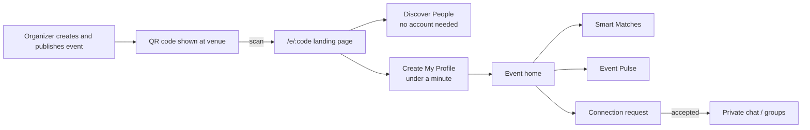
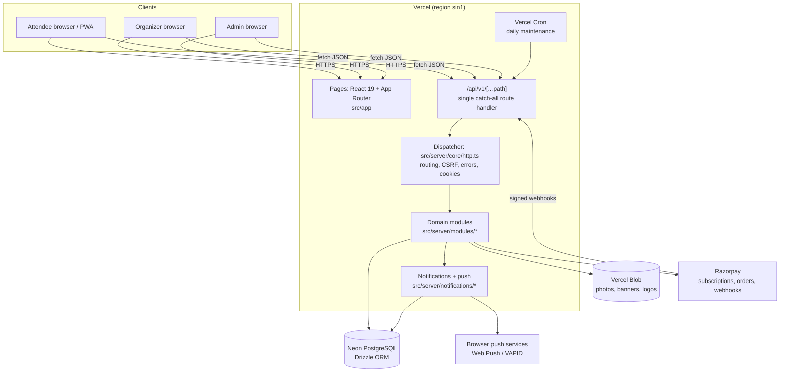
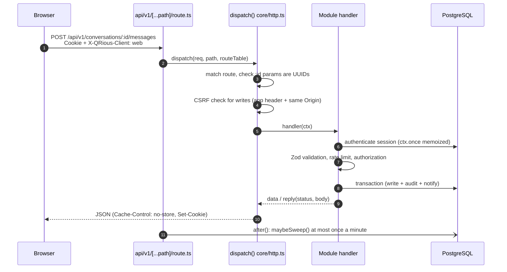
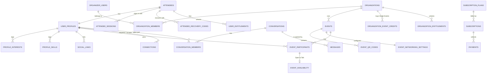
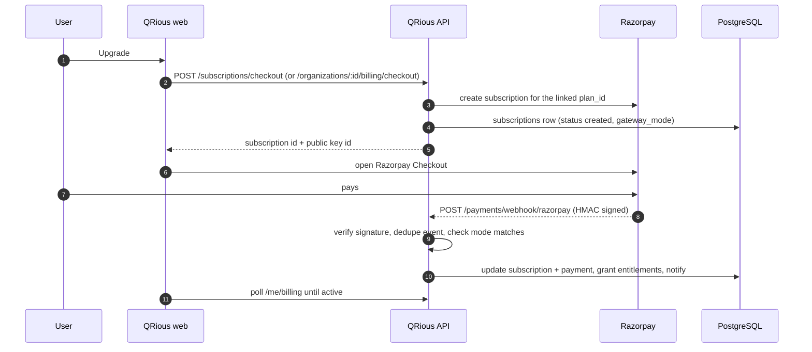
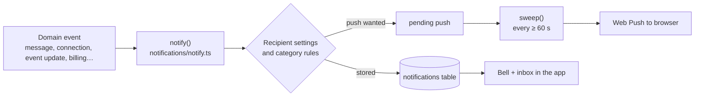
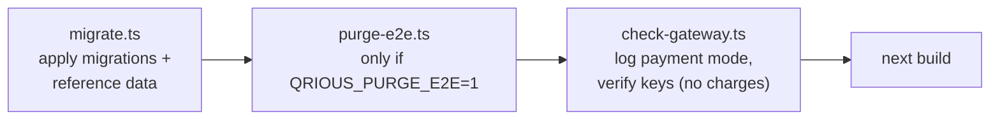

# QRious

**One event. Many connections.**

QRious is a QR-based networking platform for live events. An organizer creates an event and shows one QR code at the
venue. Attendees scan it to see who else is there, create a profile in under a minute, and connect and chat with people
at the same event. One attendee profile is reused across every event.

Live: https://qrious-rho.vercel.app

This README is the engineering handbook: what the app does, how it is built, how a request flows through it, and how to
run, test, deploy and operate it.

---

## Contents

1. [What the product does](#1-what-the-product-does)
2. [Architecture at a glance](#2-architecture-at-a-glance)
3. [Repository layout](#3-repository-layout)
4. [How a request is handled](#4-how-a-request-is-handled)
5. [Server modules](#5-server-modules)
6. [Data model](#6-data-model)
7. [Authentication and security](#7-authentication-and-security)
8. [Payments and plans](#8-payments-and-plans)
9. [Notifications and live updates](#9-notifications-and-live-updates)
10. [Frontend](#10-frontend)
11. [Configuration](#11-configuration)
12. [Running locally](#12-running-locally)
13. [Testing](#13-testing)
14. [Deployment](#14-deployment)
15. [Operations runbook](#15-operations-runbook)
16. [Conventions](#16-conventions)
17. [Further reading](#17-further-reading)

---

## 1. What the product does

There are three kinds of user.

| Role | Signs in with | Main things they do |
|---|---|---|
| **Attendee** | No email or password. A session cookie, plus a recovery code to get back in on another device | Scan an event QR, browse people, create a profile, connect, chat (1:1 and groups), set "Open to Talk" status, see Smart Matches and Event Pulse |
| **Organizer** | Email and password (optional recovery code) | Create an organization and events, publish the QR code, configure networking, manage participants, see analytics, buy plans |
| **Admin** | An organizer account promoted once with a bootstrap token, plus a TOTP authenticator | Moderate people, events and reports, manage taxonomy, link payment plans, grant promotional access, send announcements |

### The core journey



The QR code identifies the **event**, never an attendee. Attendees control their own visibility. A profile can be hidden
from visitors without an account, and every social link has its own visibility (public, members, connections).

### Plans

Networking is free. Paid plans add optional features.

| Plan | Audience | Price | Type |
|---|---|---|---|
| Free | Attendee | ₹0 | Default |
| Premium | Attendee | ₹99 / month or ₹799 / year | Razorpay subscription |
| Starter | Organization | ₹0, 3 lifetime events | Default |
| Pro | Organization | ₹499 / month | Razorpay subscription |
| Business | Organization | ₹1,499 / month | Razorpay subscription |
| Single Event | Organization | ₹199, one extra event | Razorpay one-time order |

---

## 2. Architecture at a glance

QRious is a **modular monolith in one Next.js 16 app**. The same deployment serves the pages and a JSON REST API at
`/api/v1`. Because the browser only ever talks to one origin, session cookies are first-party and host-only.



| Concern | Technology |
|---|---|
| UI | Next.js 16 App Router, React 19, Tailwind CSS v4, Motion, React Three Fiber (landing visuals), lucide icons |
| Client data | TanStack Query (caching, polling, optimistic updates) |
| API | TypeScript route modules behind one catch-all handler, validated with Zod |
| Database | PostgreSQL 16 (Neon in production), Drizzle ORM, SQL migrations in `frontend/drizzle/` |
| Files | Vercel Blob in production, local disk in development, memory in tests; images processed with `sharp` |
| Payments | Razorpay Subscriptions (recurring) and Orders (one-time), access granted by verified webhooks |
| Notifications | In-app inbox in Postgres, Web Push (`web-push`) |
| Hosting | Vercel (Hobby), daily Vercel Cron |
| Tests | Vitest against real PostgreSQL, Playwright end-to-end (mobile + desktop) |

---

## 3. Repository layout

```
QRious/
├─ frontend/                 THE APPLICATION (deployed)
│  ├─ src/
│  │  ├─ app/                Pages (App Router) and the API entry point
│  │  │  ├─ page.tsx         Public home page
│  │  │  ├─ e/[code]/        Event landing (QR target), public discover, join flow
│  │  │  ├─ app/             Attendee app: events, discover, matches, pulse, messages, profile, premium…
│  │  │  ├─ organizer/       Organizer auth + dashboard (route group "(app)")
│  │  │  ├─ admin/           Admin console
│  │  │  ├─ media/           Serves locally stored media in development
│  │  │  ├─ privacy, terms, refunds, contact
│  │  │  └─ api/v1/[...path]/route.ts   The only API route file; hands off to the dispatcher
│  │  ├─ server/             Server-only code (never shipped to the browser)
│  │  │  ├─ core/            http dispatcher, config, errors, media storage, rate limits/audit
│  │  │  ├─ db/              Drizzle schema (schema.ts) and connection (index.ts)
│  │  │  ├─ modules/         Domain modules (see §5)
│  │  │  ├─ notifications/   notify(), rules, push delivery, sweep
│  │  │  ├─ lib/             Pure helpers: tokens, recovery codes, TOTP (unit tested)
│  │  │  ├─ seed/            Reference data (categories, interests, skills, plans). No demo data
│  │  │  ├─ routes.ts        The full route table: method + path → handler
│  │  │  └─ *.test.ts        API integration tests
│  │  ├─ components/         Shared UI (ui/, organizer/, messaging/, notifications/, three/)
│  │  └─ lib/                Browser-side helpers: api client, queries, types, Razorpay checkout, push
│  ├─ drizzle/               Versioned SQL migrations + snapshots
│  ├─ scripts/               migrate, purge-e2e, check-gateway, cleanup-test-payments
│  ├─ e2e/                   Playwright journeys
│  └─ vercel.json            Build command, region, cron
├─ docs/                     PRD and the original planning pack (see §17)
├─ infra/docker-compose.yml  Local PostgreSQL 16
├─ backend/                  Archived ASP.NET Core Phase 1 implementation (reference only, not deployed)
└─ .github/workflows/ci.yml  Typecheck, lint, tests, E2E
```

---

## 4. How a request is handled

Every API call goes through the same path.



Key pieces:

- **One route table.** [frontend/src/server/routes.ts](frontend/src/server/routes.ts) lists every endpoint as
  `R(method, path, handler)`. Adding an endpoint means adding one line there and a handler in a module.
- **`Ctx`** wraps the request: parsed JSON body (max 256 KB), query, client IP, cookie helpers, and `ctx.once()` for
  per-request memoization (for example, the authenticated attendee is looked up once).
- **Errors** are thrown as `AppError(status, code, message)` and returned as RFC 7807 `application/problem+json` with a
  short `traceId`. Unexpected errors are logged with the same `traceId` and returned as a generic 500.
- **Route parameters ending in `id`** must be UUIDs, otherwise the API answers 404 before any handler runs.
- **Background work after the response:** each API call schedules `maybeSweep()` with Next's `after()`. A row lock in
  `platform_settings` makes sure it runs at most once a minute across all instances (see §9).

---

## 5. Server modules

All in `frontend/src/server/modules/`. Each module owns its tables and exposes plain async functions taking `ctx`.

| Module | Responsibility |
|---|---|
| `identity.ts` | Attendee sessions: create, validate, slide, rotate, revoke; recovery codes; device list |
| `profiles.ts` | Onboarding, profile CRUD, photo upload, interests/skills/looking-for, social links, privacy, account deletion |
| `taxonomy.ts` | Categories, interests and skills with aliases; user-created tags start as `pending` |
| `events-core.ts` | Event status machine and automatic transitions (published → active → ended) |
| `events-admin.ts` | Organizer event management: create/edit, publish, pause, QR regenerate/revoke/access, participants, export, reports |
| `participation.ts` | Joining and leaving events, per-event status ("Open to Talk"), event context |
| `discovery.ts` | Public and member people browsing with filters; enforces blocks and visibility |
| `matching.ts` | Smart Matches: a transparent 0–100 rule-based score with reasons (pure function, unit tested) |
| `pulse.ts` | Event Pulse: aggregate, anonymous activity counters |
| `social.ts` | Saved profiles, connections, 1:1 conversations, messages, read state, typing, blocks, reports, unread counts |
| `groups.ts` | Group chats: create, rename, photo, members, admins, leave |
| `organizers.ts` | Organizer accounts (scrypt passwords), sessions, organizations, members, logo, dashboard, admin bootstrap, TOTP MFA |
| `entitlements.ts` | Organization tiers (Starter / Pro / Business), feature gates, event allowance (free, plan or credit) |
| `billing.ts` | Plans, Razorpay checkout and cancel, webhook processing, Single Event orders, live/test mode separation |
| `admin.ts` | Moderation, taxonomy management, audit log, billing overview, promotional access, announcements |

Smart Matches scoring weights (from `matching.ts`): what I'm looking for vs. what they offer 30, the reverse fit 15,
shared interests 25, shared intentions 15, profession 5, availability 5, event relevance 5.

---

## 6. Data model

The full schema is in [frontend/src/server/db/schema.ts](frontend/src/server/db/schema.ts). The main relationships:



Table groups:

| Group | Tables |
|---|---|
| Attendee identity | `attendees`, `attendee_sessions`, `attendee_recovery_codes`, `idempotency_keys` |
| Profiles and taxonomy | `user_profiles`, `username_history`, `social_links`, `profile_interests`, `profile_skills`, `profile_looking_for_skills`, `event_categories`, `interests`, `skills`, `*_aliases`, `category_*_suggestions`, `networking_intentions` |
| Organizers | `organizer_users`, `organizer_sessions`, `organizer_recovery_codes`, `organizations`, `organization_members` |
| Events | `events`, `event_qr_codes`, `event_networking_settings`, `event_suggested_*`, `event_intentions`, `event_participants`, `event_availability`, `event_participant_intentions`, `event_activity_counters` |
| Social | `saved_profiles`, `match_dismissals`, `connections`, `connection_history`, `conversations`, `conversation_members`, `messages` |
| Notifications | `notifications`, `notification_settings`, `notification_preferences`, `push_subscriptions` |
| Safety and audit | `user_blocks`, `user_reports`, `moderation_actions`, `account_deletion_requests`, `audit_logs` |
| Billing | `subscription_plans`, `subscription_features`, `subscriptions`, `payments`, `payment_webhooks`, `subscription_invoices`, `event_purchases`, `organization_event_credits`, `user_entitlements`, `organization_entitlements`, `promotional_access` |
| Platform | `platform_settings`, `rate_limit_counters` |

Status values are text columns guarded by check constraints. The allowed values are the `as const` arrays at the top of
`schema.ts` (for example `EVENT_STATUS = draft, published, active, networking_paused, ended, archived`).

### Migrations

- Change `schema.ts`, then run `npm run db:generate` to create a new SQL file in `frontend/drizzle/`.
- `npm run db:migrate` (`scripts/migrate.ts`) applies pending migrations and upserts reference data (categories,
  interests, skills, plans). It never inserts demo users or events.
- Production runs migrations automatically at the start of every Vercel build (see §14).

---

## 7. Authentication and security

### Sessions

| | Attendee | Organizer / Admin |
|---|---|---|
| Credential | None. Account is created on onboarding; a recovery code restores it elsewhere | Email + password (scrypt) |
| Cookie | `qr_s` | `qr_o` |
| Lifetime | 30 days idle, 180 days absolute | 7 days idle; 12 hours idle for admin accounts |
| Storage | Only a SHA-256 hash of the token is stored | Same |
| Rotation | Token rotates every 24 h with a 2-minute grace window. Replaying a rotated-out token revokes the session | — |

Cookies are `HttpOnly`, `SameSite=Lax`, host-only, and use the `__Host-` prefix with `Secure` over HTTPS.

Recovery codes look like `QRS-XXXX-XXXX-…`. They are hashed with a server-side pepper (`QRIOUS_RECOVERY_PEPPER`) and
shown to the user once.

### Request protection

- **CSRF:** every non-GET request must send `X-QRious-Client: web` (or `mobile`) and come from the same origin
  (checked against `Origin` or `Referer`). The payment webhook is the only exemption, and it is verified by HMAC instead.
- **Rate limits:** stored in Postgres (`rate_limit_counters`), so they hold across serverless instances. IPs are
  hashed with `QRIOUS_IP_SALT` before storage.
- **Idempotency:** creating a profile and similar one-shot writes accept an `Idempotency-Key` header
  (`idempotency_keys`), so a retried request can't create duplicates.
- **Authorization** lives in the modules: participants only see people at events they joined, blocks hide both sides,
  profile and link visibility is enforced server-side, and organizers only see their own organizations.
- **Audit:** sensitive actions (moderation, billing changes, admin actions, webhook mismatches) write to `audit_logs`.
- **Uploads:** images are re-encoded with `sharp` (strips metadata) and stored under random, unguessable keys.

### Admin

The first admin is created once: register an organizer, then enter `QRIOUS_ADMIN_BOOTSTRAP_TOKEN` under Organizer →
Account. That account must then enroll a TOTP authenticator before `/admin` opens.

---

## 8. Payments and plans

Payments use Razorpay. **Access is only ever granted by a verified webhook**, never by the browser saying "payment
succeeded".

### Subscription flow (Premium, Pro, Business)



### Single Event flow (one-time)

1. `POST /organizations/:id/billing/event-credits/order` creates a Razorpay order.
2. After checkout, `…/event-credits/verify` checks the checkout signature, then fetches (and if needed captures) the
   payment server-to-server and grants one event credit.
3. The `payment.captured` / `order.paid` webhooks grant the same credit idempotently, so it works even if the browser
   closes before verify.

### Rules worth knowing

- **Mode comes from the key prefix.** `rzp_test_…` is test mode and `rzp_live_…` is live mode. Live keys stay disabled
  unless `RAZORPAY_ALLOW_LIVE=1` is set. Payments also need `RAZORPAY_WEBHOOK_SECRET`.
- **Test and live records never mix.** Plans, subscriptions, payments and webhooks store `gateway_mode`. In live mode,
  test-mode plan links and leftover test subscriptions are ignored.
- **Plans are linked in Admin → Revenue.** Each paid plan must be linked to a Razorpay `plan_id` for the current mode.
  The admin validates the period, amount and currency before saving. Until a plan is linked, it shows as unavailable.
- **Cancel** calls Razorpay first and only records the cancellation if Razorpay accepted it. Access continues until the
  end of the paid period.
- **Refunds** processed in the Razorpay Dashboard arrive as `refund.processed` and remove the access that payment
  unlocked. An event already created with a refunded Single Event is never deleted.
- **Webhook URL:** `https://<site>/api/v1/payments/webhook/razorpay`, with events: all `subscription.*`,
  `payment.captured`, `payment.failed`, `order.paid`, `refund.processed`.

Feature gates for organizations are defined in `ORG_FEATURES` in `entitlements.ts` (for example `org.branding` needs
Pro, `org.members` needs Business). Attendee Premium features are plan features in the `subscription_features` table.

---

## 9. Notifications and live updates

### In-app and push notifications



- Every notification is written in the same transaction as the action that caused it, with a `dedupe_key` so a retry
  can't send it twice.
- Attendees and organizers each have per-category settings (messages, groups, connections, events, matches, billing,
  account, security, announcements).
- **The sweep** (`notifications/api.ts`) runs after API responses at most once a minute, plus from the daily cron. It:
  applies automatic event status changes, sends 24-hour and 1-hour event reminders, and delivers pending pushes.
- Web Push uses VAPID keys. The browser fetches the public key from `GET /push/config`.

### Live updates

There are no WebSockets: Vercel serverless functions don't hold connections open. The UI stays fresh by polling with
TanStack Query, and polling pauses while the tab is in the background.

| Data | Interval |
|---|---|
| Conversation list | 8 s |
| Event Pulse | 10 s |
| Unread counts (messages, requests, notifications) | 15 s |
| Connections, organizer notifications | 20 s |
| Event details | 60 s |

An open chat thread polls every 3 s and sends typing signals (`POST /conversations/:id/typing`).

---

## 10. Frontend

- **Routing:** App Router. `/e/[code]` is server-rendered (fast first paint from a QR scan). The attendee app (`/app/*`),
  organizer dashboard (`/organizer/*`) and admin (`/admin`) are client-rendered behind session guards
  (`RequireAttendee` in `components/AppShell.tsx`, the organizer shell in `components/OrganizerShell.tsx`).
- **Data access:** `src/lib/api.ts` is a small `fetch` wrapper that adds `X-QRious-Client: web`, parses problem
  responses into errors, and is used by the TanStack Query hooks in `src/lib/queries.ts`.
- **Shared types** for API responses are in `src/lib/types.ts`.
- **Layout:** mobile-first. On phones the attendee and organizer apps use a bottom tab bar; on desktop a top bar
  (attendee) or sidebar (organizer). Attendee pages use `AttendeePage` / `PageContainer`: a wide `max-w-7xl` frame,
  unless a page passes its own `max-w-*` (forms and settings stay narrower).
- **Design tokens** (colors such as `bg`, `card`, `text-2`, `accent`, gradients) are defined in `src/app/globals.css`
  for Tailwind v4.
- **Razorpay Checkout** is loaded on demand by `src/lib/razorpay.ts`.
- **Legal pages** (`/privacy`, `/terms`, `/refunds`, `/contact`) share `components/LegalPage.tsx`. Text the owner still
  has to write is wrapped in `<Placeholder>` and rendered highlighted. Search the code for `<Placeholder` to find it.

---

## 11. Configuration

Environment variables (names only; never commit values). Local defaults are in `frontend/.env.example`.

| Variable | Required | Purpose |
|---|---|---|
| `DATABASE_URL` | Yes | Postgres connection (Neon pooled URL in production) |
| `DATABASE_URL_UNPOOLED` | Production | Direct connection used by migrations |
| `QRIOUS_RECOVERY_PEPPER` | Yes | Pepper for hashing recovery codes (min 16 chars). Changing it invalidates every recovery code |
| `QRIOUS_IP_SALT` | Yes | Salt for hashing IPs in rate limits |
| `NEXT_PUBLIC_SITE_URL` | Yes | Public origin; QR codes encode this URL |
| `CRON_SECRET` | Production | Authorizes Vercel Cron calls to `/api/v1/cron/maintenance` |
| `QRIOUS_ADMIN_BOOTSTRAP_TOKEN` | Once | One-time token to create the first admin |
| `BLOB_READ_WRITE_TOKEN` | Production | Vercel Blob storage. Without it, files go to `.data/media` on local disk |
| `RAZORPAY_KEY_ID`, `RAZORPAY_KEY_SECRET` | For payments | `rzp_test_…` or `rzp_live_…` key pair |
| `RAZORPAY_WEBHOOK_SECRET` | For payments | Secret of the Razorpay webhook in the same mode as the keys |
| `RAZORPAY_ALLOW_LIVE` | Live only | Must be `1` to enable live keys |
| `VAPID_PUBLIC_KEY`, `VAPID_PRIVATE_KEY`, `VAPID_SUBJECT` | For push | Web Push key pair and contact subject |
| `QRIOUS_PURGE_E2E` | Build-time, optional | `1` makes the build delete end-to-end test accounts |

On Vercel, environment variable changes apply only to the **next** deployment.

---

## 12. Running locally

Prerequisites: Node 24 and Docker.

```bash
docker compose -f infra/docker-compose.yml up -d     # PostgreSQL 16 on localhost:5432
cd frontend
cp .env.example .env.local                           # local defaults
npm install
npm run db:migrate                                   # schema + reference data (no demo data)
npm run dev                                          # http://localhost:3000
```

Then:

1. Open `/organizer/register`, create an account and an organization.
2. Create and publish an event, open the **QR code** tab, and follow the event link. That's the page a scan opens.
3. Choose **Create My Profile** to become an attendee. Use a second browser profile to be a second attendee.

Payments stay off locally until you add Razorpay test keys and a webhook secret. To receive webhooks locally, expose the
dev server with a tunnel and point a test-mode webhook at it.

---

## 13. Testing

```bash
cd frontend
npm run typecheck
npm run lint
npm test                 # Vitest: unit + API integration tests against a real PostgreSQL database
npm run build && npm start
npm run test:e2e         # Playwright journeys on a mobile and a desktop profile
```

- **Integration tests** (`src/server/*.test.ts`) call the real route handlers against a real Postgres database
  `qrious_test` (created and migrated by `src/server/test/global-setup.ts`). Set `TEST_DATABASE_URL` to use another
  server. They cover the API, billing (including live/test separation and every Premium gate), messaging and
  notifications. Razorpay is mocked; no test calls the real gateway.
- **Pure logic** (`src/server/lib/*.test.ts`) covers tokens, recovery codes and TOTP.
- **End-to-end** (`e2e/*.spec.ts`) creates its own organizer, event and attendees with `@example.com` emails. Run it
  against a deployment with `E2E_BASE_URL=https://… npm run test:e2e`, then clean up (see §15). Set
  `E2E_SCREENSHOTS=<dir>` to save screenshots. The admin journey runs only with `E2E_ADMIN_TOKEN`.
- **CI** (`.github/workflows/ci.yml`) runs typecheck, lint and tests with a Postgres service, then the E2E suite.

---

## 14. Deployment

Production runs on Vercel from the `frontend/` directory, region `sin1` (Singapore), with Neon Postgres.

```bash
cd frontend
npx vercel@latest deploy --prod --yes
```

`vercel.json` sets the build command to `npm run vercel-build`, which runs four steps in order:



If any step fails, the deployment fails and the previous version keeps serving. Read the build log after a deploy:
`check-gateway` prints the payment mode (`test`, `live` or disabled) and whether Razorpay accepted the keys.

Vercel Cron calls `GET /api/v1/cron/maintenance` daily at 03:00 UTC (authorized by `CRON_SECRET`).

Deploys can also come from GitHub by connecting the repository in Vercel → Settings → Git; every push to `main` then
deploys.

---

## 15. Operations runbook

| Task | How |
|---|---|
| Remove E2E test data from production | `npx vercel@latest deploy --prod --yes --build-env QRIOUS_PURGE_E2E=1`. It only touches accounts created by the E2E suite (`@example.com`) and their data |
| Remove test-mode payment records after going live | `npx tsx scripts/cleanup-test-payments.ts` with `DATABASE_URL` set to the unpooled production URL. It is a dry run by default and prints counts. Apply with `--apply --expect=N` using the count it printed. One transaction; refuses if anything looks unsafe |
| Link or replace a Razorpay plan | Admin → Revenue → Razorpay plans: paste the `plan_…` ID and choose **Link**, **Replace** or **Unlink** |
| Check payment configuration | Admin → Revenue shows a checklist (never secret values); the build log shows `payments: … mode=…` |
| Refund a payment | Razorpay Dashboard → Payments → Refund. The `refund.processed` webhook removes the access it unlocked |
| Grant free access | Admin → Promotional access (attendee Premium or an organization tier, with an end date) |
| Moderate | Admin → Reports, Attendees, Organizations, Events (suspend / restore). Every action is audited |
| Roll back a bad deploy | Vercel Dashboard → Deployments → previous deployment → Promote to Production. Migrations are forward-only, so code must stay compatible with the newer schema |

---

## 16. Conventions

- **Server code** imports `server-only` and lives in `src/server`. Pages call the API; they never import server modules.
- **Validate at the edge** of every handler with Zod. Throw `AppError` with a stable `code` the UI can switch on.
- **Writes that belong together** go in one `db.transaction()`, including the audit row and notifications.
- **No demo data** in seeds or migrations. Reference data only.
- **Secrets** are never committed, logged or shown in the UI. `*.local.txt` and `.env*` files are git-ignored.
- **Money** is stored as integer minor units (`price_minor` in paise) with a currency code.
- **Times** are stored in UTC (`timestamptz`); events carry an IANA `time_zone` for display.
- **Tests first for rules:** matching, entitlements and billing changes come with integration tests.

---

## 17. Further reading

- [docs/PRD.md](docs/PRD.md): full product requirements.
- [docs/00-README.md](docs/00-README.md): index of the planning pack.
- [docs/02-decisions-and-conflicts.md](docs/02-decisions-and-conflicts.md): numbered decisions (D-xx) referenced in
  code comments.
- `docs/03`–`docs/10`: original architecture, schema, API, security, deployment and guidelines. These were written for
  the first ASP.NET Core design (now in `backend/`). Decision D-29 moved everything into the single Next.js app described
  here, so where they disagree with this README, this README and the code are current.
